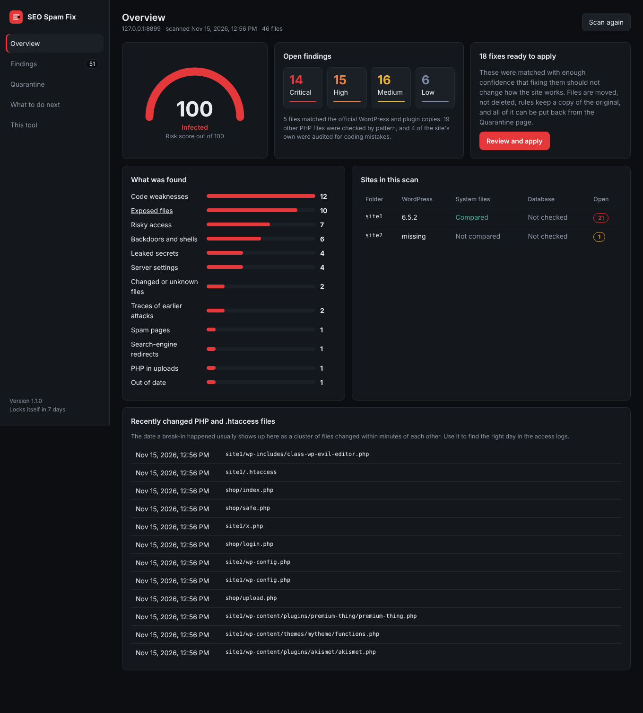
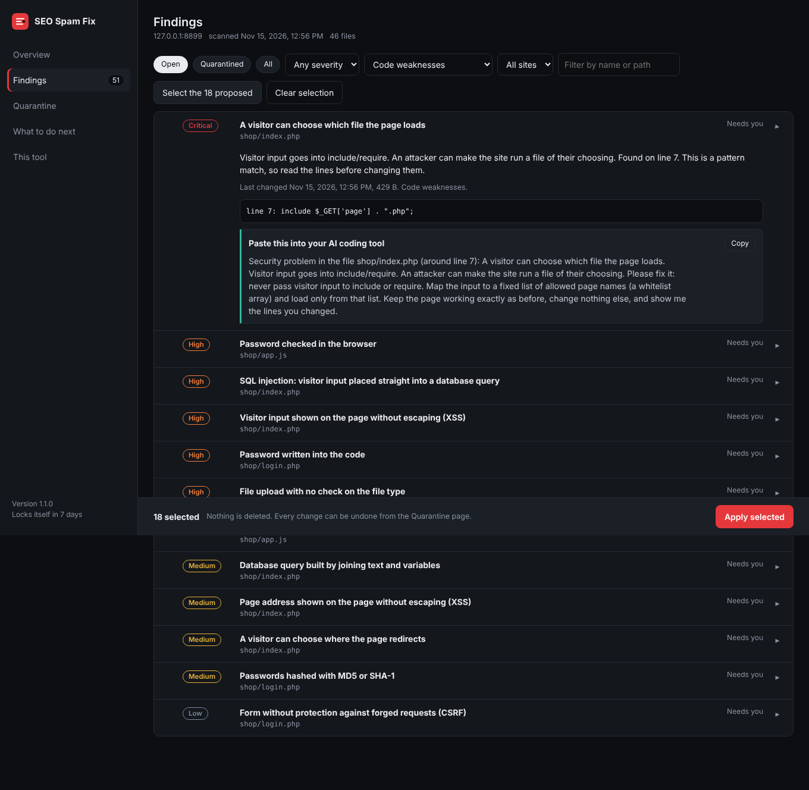

# SEO Spam Fix

One PHP file that checks a cPanel hosting account for two things and fixes what
it safely can:

- **Infection:** gambling and pharmacy spam pages, search-engine-only
  redirects, web shells and the leftovers that let attackers come back.
- **Weak spots:** leaked API keys, files that should not be downloadable,
  unsafe server settings and common coding mistakes, in WordPress sites and in
  hand-built or AI-built ("vibe-coded") PHP, HTML and JavaScript sites.

Nothing is ever deleted. Files are moved to a quarantine folder outside the
website, `.htaccess` changes keep the original, and every run can be undone
with one click. What it cannot fix it explains, with a ready-made instruction
to paste into an AI coding tool.

## What it checks

### Infection

| Area | What it looks for |
|---|---|
| Spam pages | Folders and HTML files that serve spam, including folders named after a real page so they are shown instead of it |
| Redirects | `.htaccess` rules that send Googlebot, Bing and other crawlers somewhere else |
| WordPress core | Every system file compared with the official checksums; unknown files hidden in `wp-admin` and `wp-includes` |
| Plugins | Every WordPress.org plugin compared with its official release |
| Backdoors | Web shells, packed payloads, uploaders, PHP hidden in images, PHP in `uploads` and `mu-plugins` |
| Database (read-only) | Spam in posts, executable-looking settings, open administrator registration, administrator accounts |
| History | Emptied backdoor files from earlier clean-ups and the most recently changed PHP files |

### Security audit

| Area | What it looks for |
|---|---|
| Leaked secrets | OpenAI, Anthropic, Stripe, Paystack, Flutterwave, AWS, GitHub, SendGrid and other keys, Supabase service-role keys, private keys and database passwords in JavaScript, HTML, JSON and other files the browser can read |
| Exposed files | `.env`, `.git`, database dumps, SQLite files, backup copies of PHP files, `phpinfo()` pages, Adminer, installer leftovers, the PHPUnit `eval-stdin.php` hole, logs, key files |
| Server settings | End-of-life PHP, errors shown to visitors, `allow_url_include`, no HTTPS redirect, missing security headers, folder listing, world-writable files, PHP allowed to run in uploads |
| PHP code | SQL injection, XSS, file inclusion, path traversal, command injection, unsafe `unserialize`, uploads with no type check, passwords in the code, MD5/SHA-1 passwords, open redirects, `extract()` on input, forms without CSRF protection |
| JavaScript | Passwords checked in the browser, `eval` and `innerHTML` fed from the page address |
| Other | Python or Node source left in a web folder, debug mode on, Supabase and Firebase used straight from the browser |

Code is audited only in the site's own files. WordPress, its plugins and
themes, and bundled libraries (`vendor`, `node_modules`, jQuery and similar)
are compared with official copies or scanned for malware instead.

## What it fixes, and what it leaves to you

| It can apply (all reversible) | It reports, with instructions |
|---|---|
| Move spam folders, backdoors, exposed dumps, backup copies, `phpinfo`, Adminer and installers to quarantine | Code weaknesses: file, lines and an instruction for your AI coding tool |
| Remove search-engine redirect blocks from `.htaccess` | Leaked keys: which provider to revoke them at |
| Add a "protect files" block to `.htaccess` (hidden files, backups, dumps, logs, folder listing) | Changed WordPress or plugin files: what to reinstall |
| Add basic security headers | PHP version, HTTPS redirect, error display: where in cPanel |
| Stop PHP running in WordPress uploads | Database spam, unknown administrators |
| Tighten world-writable permissions | Supabase and Firebase access rules |

Fixes the scan is confident about arrive ticked. Anything that could change how
a site behaves (headers, uploads rule, permissions, a suspicious file inside a
theme) is left unticked for you to decide. If a new `.htaccess` rule makes the
server return an error, it is rolled back automatically.

## Use

1. Open `seo-spam-fix.php` in an editor and set a password of at least
   8 characters on the `SSF_PASSWORD` line. The tool refuses to run until you do.
2. Upload it with cPanel File Manager into a site's folder, or into
   `public_html` to cover every site in the account.
3. Open `https://your-domain/seo-spam-fix.php` and sign in.
4. Choose where to scan and start. Large accounts take a few minutes.
5. Read **Findings**, untick anything you want to leave, then **Apply selected**.
6. Open the site in a private window and click through it. If anything is
   wrong, go to **Quarantine** and restore the run.
7. Follow **What to do next** and download the report.
8. Use **This tool > Delete this tool** when finished.

Command line, read-only, for Terminal or cron:

    php seo-spam-fix.php scan /home/USER/public_html > report.txt

## If the file disappears after upload

Hosts that run a real-time malware scanner (Imunify360, ImunifyAV, ClamAV,
Maldet) delete files that look like malware the moment they are uploaded.
A malware *finder* is an easy false positive, because it has to contain the
signatures it looks for. The release file is built to avoid this (see
"Releases are encoded" below) and is checked against public web-shell rules,
but a host's own commercial rules can still disagree. If it happens:

1. Check the host's scanner (in cPanel or WHM, the Imunify360 or "Malware
   Scanner" page). It will list `seo-spam-fix.php` with the rule that matched.
2. Restore it from there or add it to the ignore list if you are allowed to,
   or ask the host to allow it.
3. Please open an issue with the rule name so the next release can avoid it.

Do not rename it to something innocent-looking to get past the scanner; that
is what malware does, and it teaches nothing.

## How it protects itself

- No default password; locks for 15 minutes after 6 wrong attempts.
- Stops working 7 days after upload (`SSF_EXPIRE_DAYS`), so a forgotten copy
  is not left usable. Upload it again to continue.
- Scan data and quarantine live in `~/ssf-data`, outside the web root, with a
  protected fallback folder if the home folder is not writable.
- Leaked keys are masked in the report.
- No external scripts, fonts or trackers. Outbound requests go only to
  WordPress.org (checksums, current version) and to the site itself (HTTPS,
  headers and folder-listing tests).

## What it cannot do

- Tell you how an attacker got in, or prove a site is clean or secure.
- Find mistakes in how a site is meant to work: who may see what, prices or
  roles changed by a visitor, pages that forget to check the login.
- Verify premium plugins, custom plugins or themes against an official copy.
- Change the database, or repair changed core and plugin files.
- See access rules held elsewhere (Supabase, Firebase), or what a leaked key
  was used for.
- Check library versions against known vulnerabilities (planned).

The code audit is pattern matching. Expect some false alarms and some misses,
and have a person review anything that handles money or personal data. Sites
that are legitimately about gambling or pharmacy will trip the spam checks.

## Requirements

PHP 7.4 or newer. `curl` or `allow_url_fopen` for checksum and web tests,
`mysqli` for the database checks; the scan still runs without them and says
what was skipped.

## Developing

The release file is built from the parts in `src/`:

    ./build.sh          # writes seo-spam-fix.php and syntax-checks it

| File | Contents |
|---|---|
| `src/10-helpers-rules.php` | Settings, helpers, malware signatures (`ssf_sigs`), spam terms (`ssf_spam`), `.htaccess` analysis |
| `src/20-scan-sites.php` | Scan start, WordPress site and database checks |
| `src/30-scan-files.php` | Per-file infection checks, resumable walk, results |
| `src/35-audit.php` | Security audit: `ssf_secret_rules`, `ssf_code_rules`, `ssf_js_rules`, exposed files, hardening blocks |
| `src/40-actions-report.php` | Quarantine, restore, recommendations, report, command line |
| `src/50-web.php`, `src/60-app.js` | Sign-in, API, dashboard |

`build.sh` joins the parts, then `build/encode.php` stores every string that a
malware scanner would react to (shell names, spam words, `eval(base64_decode(`
patterns and similar) ROT47-encoded, decoded at run time by `ssf_d()`. Nothing
is executed from the encoded text; it only keeps the detection rules from
looking like the thing they detect. The source in `src/` stays readable. If a
trigger word ends up somewhere the encoder cannot reach (a `static` initialiser,
a string with variables in it), the build stops and says where.

`tests/scan-self.py` then scans the release with the public php-malware-finder
and signature-base web-shell rules. Install `yara-python` and clone both rule
sets into `../rules/` (instructions at the top of the script) to run it. Never
publish a release that fails it.

Other rules for keeping the release scanner-friendly: read request values only
through `ssf_post()`, `ssf_query()` and `ssf_srv()`; do not call shell
functions; avoid lines that join five or more variables with `.` (use
`sprintf`).

Most new checks are one row in a rule table. Each code rule has a pattern, a
"safe if the match contains" pattern, an explanation and a fix instruction.

`tests/make-fixture.sh` builds a fake infected account (two WordPress sites
and one hand-built site) under `/home/ssftest`. Run it as root in a throwaway
container, never on a real server, then scan it and check that expected
findings appear and that `safe.php` produces none.

When reporting a false alarm or a miss, include the finding title and the
line that matched (with secrets removed).

## Licence

MIT. See `LICENSE`.
